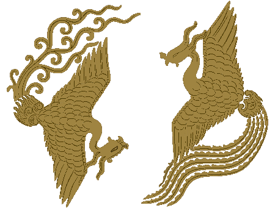

# 传统纹样向高铁车身涂装转译：提示词优化说明与迭代记录

日期：2026-09-17  
范围：纹样转化画布中的提示词优化、自动化实现及龙纹／凤纹试验。  
性质：阶段性设计与工程记录，不是已完成受控实验的效果论文。

## 摘要

> 后续实施更新（2026-09-17）：已根据用户补充要求接入后台 `livery/detail` 语义分流。整体涂装采用领域规则，指定修改只做轻量表达整理；已移除画布的提示词优化面板、候选和推荐卡。下文保留此前探索时点的记录；其中“旧面板仍展示”等状态已被此次更新替代。详见 [双路径实施记录](../superpowers/plans/2026-09-17-quiet-prompt-routing.md)。本次没有新增真实图像质量实验。

我们要解决的不是“怎样把一句话写得更专业”，而是：用户选中传统纹样、提出较模糊的设计意图后，系统怎样结合实际图像，明确哪些内容应保留、哪些部位应改变，并生成适合后续在高铁车身上排布的独立纹样素材。

探索经历了文字建议、保留型／探索型方向、多方案素材板、收紧变化范围，以及看图后再优化等阶段。主要教训是：过度强调探索会偏离原型；过度锁定轮廓又会使变化不足；识图也会犯错，并可能把错误传递给生图模型。

目前本地系统已接入“Codex 看图并输出优化提示词 → 使用同组参考图生成单个纹样”的两阶段链路。最新凤纹试验采用了“保留辨识特征、简化内部羽片、定向延展尾羽”的策略，得到用户明确正向反馈。该凤纹结果来自对话中的人工辅助提示词组织与内置生图调用，不是自动链路已经复现的结果。

核心结论：**优化的价值在于明确修改对象、动作和边界，而不是堆叠风格词，也不是让所有纹样都变成同一种流线。**

## 1. 背景是什么

### 1.1 项目的真实工作流

用户先从文化主题和纹样检索中选取素材，在纹样转化画布中进行再设计，再截取、摆放到车身白模或布局中，最后结合布局、案例、配色和说明生成整车效果。

因此必须区分两个产物：

- **纹样转化阶段**：独立、完整、便于截取与放置的平面装饰素材。
- **最终效果阶段**：体现车体、车窗带、布局、案例参考与配色关系的整车效果图。

“适用于高铁车身”是前一阶段的应用目标，不等于要求生图模型在这一阶段直接画列车。

### 1.2 为什么需要提示词优化

用户通常会表达“现代简化”“更有速度感”“线条流畅一点”，但不一定会说明改哪里、保留什么、改变多少，以及输出应是独立素材还是整车。

直接把这些词交给生成模型，可能出现两种相反结果：一是基本照搬原纹样，修改不足；二是大幅重画，虽然看起来更现代，却丧失原始纹样的特征。

我们希望降低表达门槛，而不是把用户训练成提示词工程师。系统应结合当前图片，将模糊意图翻译为少量具体、可执行的视觉操作。

### 1.3 为什么采用低成本模型调用

当前目标是验证工作流，不是训练专用优化器，也不是给全库纹样逐个做视觉标注。按次分析用户当前选择的图片，结合领域规则调用已有模型，能够先验证这种机制是否有用。

早期项目调研借鉴了编辑式提示词增强、保留／修改边界和关键点检查。没有直接部署这些项目的专用模型，也没有理由将它们的通用评测成绩当作本项目的效果。

## 2. 冲突是什么

| 冲突 | 具体表现 | 当前取舍 |
| --- | --- | --- |
| 原型保留与创新 | 锁定全部轮廓则变化小；大幅抽象则失去原型 | 保留关键辨识特征，对指定部位做明确调整 |
| 用户意愿与领域默认值 | 用户只想轻度简化，系统却强制几何化、换色或极度拉长 | 用户明确要求优先，领域策略按需使用 |
| 高铁适配与素材独立性 | “融入车身”可能诱导模型画车体、场景和整车排版 | 明确用途是涂装，但本次只输出纹样 |
| 多样性与可控性 | 四方案同时探索造型、抽象和构图，差异过大 | 暂回到单方案，先验证基本转化质量 |
| 自动识别与事实可靠性 | 左右朝向、附属结构可能被误读 | 不确定处不写死，文字与原图冲突时以图为准 |
| 专业表述与实际效果 | 提示词更长、更专业，不代表图像更符合需求 | 评价生成图，而非仅评价提示词文本 |
| 可用素材与制造落地 | 看起来像矢量或可喷涂，不等于已经可生产 | 当前交付位图概念素材，工艺适配另行检查 |

另有一个表达冲突：用户认可的程度可能是“保守但有创新”，这并不等于不改变形态，而是保留识别基础、允许局部有目的地重组。单靠“保守”“探索”标签不足以描述这种边界。

## 3. 我们为什么这样设计

### 3.1 从“扩写描述”改为“制定编辑指令”

“高级、现代、科技、流畅”等词没有明确修改对象。与其增加形容词，不如回答五个问题：

1. 本次处理图片里的哪个主体？
2. 用户明确要求改什么？
3. 哪些特征需要保留？
4. 哪些具体动作能够实现要求？
5. 输出需要满足什么阶段边界？

例如，“凤更流畅”可以落实为“合并密集小羽片，保留凤首与展翼关系，将长尾整理为少量连续、渐细的线带”。这既说明了修改，也避免把整只凤改成无来源的抽象图形。

### 3.2 先看实际图片，再组织提示词

同为龙纹或凤纹，其姿态、主轴、轮廓和细节可能不同。仅凭名称和图谱元数据，无法可靠指定这一张图的修改部位。

视觉观察用于识别当前图片中的主体、姿态、主次线条、密度和配色；图谱信息可辅助确认名称与来源，但不能替代看图，也不能让模型凭空生成文化解释。

观察与设计建议应分开：前者描述看见什么，后者解释建议怎样改。这样才能判断错误来自识别还是转译。

### 3.3 保留辨识特征，而不是每一条线

保留全部线条会阻碍简化；只保留一个“凤”或“龙”的类别，又可能让模型重画另一种造型。中间的合理单位是这张参考图的关键特征及其关系，例如凤首与冠羽、抬起的翼、弯曲躯干和长尾。

我们采用的工作假设是：**主体识别稳定，内部细节可简化，局部结构可按目的延展。** 这不是适用于所有任务的强制约束；用户明确要求彻底重构时应允许更大变化。

### 3.4 高铁适配采用条件规则，而不是统一审美模板

用户提供的《传统纹样向高铁车身涂装转译的提示词优化框架》提供了有价值的拆解：载体、核心特征、动势、比例、抽象、留白、配色等。

但“任何纹样都极度横向拉伸”“避免所有中心对称”“必须开放轮廓”“固定深色与金色”不能作为无条件规则。它们可能与用户的保留意愿冲突，也容易造成风格同质化。

本项目借鉴的是其**分析维度和策略库**，而不是完整照搬元提示词。比如尾羽可自然延展的凤纹，优先调整尾羽；不应为追求长条构图而机械压扁凤首和翼形。

### 3.5 修改程度应由操作范围表达

| 程度建议 | 操作范围 | 默认保留 |
| --- | --- | --- |
| 轻度整理 | 去除碎线、统一线宽、清理边缘 | 主轮廓、姿态、比例 |
| 适度转化 | 合并内部结构、调整局部曲线与比例、延展局部 | 主体身份、关键特征及主要关系 |
| 探索重构 | 改骨架、改构图或表现语言 | 经用户确认的少数核心特征 |

这是后续可采用的设计表达，不是当前模型已有的精确强度参数，也尚未全部实现为界面选项。最新凤纹可归为“适度转化”。

### 3.6 参考项目带来了哪些启发

以下为此前本地调研的归纳，本次文档整理没有重新核验远程项目版本。

| 参考 | 借鉴点 | 没有照搬的部分 |
| --- | --- | --- |
| Prompt Optimizer | 明确编辑对象、操作与保留范围；原文与结果对照 | 不整体嵌入其产品，不套用全部默认风格 |
| Qwen-Image 编辑提示词工具 | 图片与编辑需求共同输入；模糊时做必要补充 | 不套用文生图的场景、美学扩写 |
| Hunyuan PromptEnhancer | 将意图拆成可检查关键点；重视否定和属性绑定 | 未部署或训练其优化器，不引用其成绩作为项目收益 |
| Promptist | 优化效果依赖下游生图器；应看实际图像与人类偏好 | 不使用面向旧生成器的权重作为直接解决方案 |

原始来源、规则细节及证据边界见文末的两份既有调研记录。

## 4. 我们是怎么实现的

### 4.1 当前本地自动链路

```text
用户原始输入 + 当前选中图层的参考图
    ↓
第一轮 Codex：观察附件，输出 observations 与 optimizedPrompt
    ↓
程序校验：观察与提示词是否存在、类型及长度是否合法
    ↓
第二轮 Codex：同组参考图 + 优化文本 + 原始要求 + 单图／朝向约束
    ↓
内置 image_generation 返回图片
    ↓
图片解码校验 → 现有透明化处理 → 返回画布
    ↓
本地留存提示词与参考图哈希，便于追溯
```

这是两个模型轮次。第一轮内部同时完成观察和提示词组织，并非已经实现“独立观察模型、独立转译模型、独立视觉审查模型”三个服务。

接入点为 `gaotie-server/src/super-canvas/super-canvas.service.ts` 的 `analyzeMotif: true`；两阶段流程位于 `gaotie-server/src/codex-image/codex-image-client.ts`。最终整车效果生成不启用该纹样分析模式。

### 4.2 自动优化的现有规则

- 观察主体、姿态、轮廓、主次线条与色彩；不确定处明确说明，不猜文化寓意。
- 保留用户明确的动作、风格、颜色与禁止项，将模糊动作补成具体视觉操作。
- 不强加极简、流线、金色等未要求的偏好，不添加无关装饰。
- 保留主体辨识特征，但不锁死每条原始线条。
- 默认生成单个完整独立纹样，不生成车体场景或多方案拼图。
- 默认不镜像；文字对左右的描述若与图片冲突，以图片为准。
- 图片中的文字作为素材数据，而不是可改变系统行为的指令。

程序只做结构、长度和调用阶段校验；**没有实现可靠的视觉语义校验器**。它能够拒绝缺字段结果，却不能保证观察到的朝向或主体一定正确。

### 4.3 失败处理与记录

观察输出无法解析或缺少必要内容时，不继续生图；任务有超时与取消处理，不静默退回纯文字优化。适配器限制额外工具调用，保持本地生成任务的范围。

生成记录包含 `originalPrompt`、`observations`、`optimizedPrompt`、`generationPrompt`、工具返回的 `revisedPrompt`（如有）、任务标识和参考图片哈希，保存在后端 `generated/prompt-audits`。该目录不作为图片静态目录发布。

`generationPrompt` 是系统实际提交给生图轮次的文本；`revisedPrompt` 是工具返回的修订文本，二者不应混称。早期未留档的生成不能靠后来的画布输入反推完整历史。

### 4.4 仍需明确的产品边界

1. 旧“优化提示词”面板仍是名称／元数据驱动的文字建议；新的视觉优化发生在点击“AI 转化”之后。两者尚未统一。
2. 参考图仍使用图层 `src`。仅修改图层 `crop` 的裁切范围尚未烘焙进实际提交图片；要准确传入局部，应使用截取功能生成的独立图片。
3. 审计记录已留存，但不是已经完成的前端逐图对照界面。
4. 当前单方案输出是实验阶段产品约束。如果用户要求多方案，会与该约束产生冲突，不能宣称所有输出要求都能无条件优先。
5. 提示词中的“矢量风格”不等于 SVG 等矢量文件；透明化与制造文件制作也不是一回事。

## 5. 中间经历了哪些案例与调整

本节按探索顺序整理。用户反馈、人工观察和机制推测分别标注，不把推测写成已定位根因。

### 案例一：文字优化不等于看图优化

早期优化器使用选中纹样名称与元数据生成建议，没有实际观察图片。用户随后询问优化是否结合图片形态。

**问题**：模板可以写出“保持龙纹身份”，却不知道具体姿态和线条。用户也容易误以为提示词已经经过视觉分析。

**调整**：明确旧面板能力边界，并在本地生图入口增加实际附件驱动的观察阶段。

### 案例二：两张转化结果被认为变化不足

用户认为龙纹生成结果与原纹样变化不大，希望看到现代简化和更流畅的线条。

**证据边界**：当时缺少逐图原始提示词与实际发送文本的完整记录，不能断言哪一条限制导致了该结果。也不能确定第二次是否使用了上一次生成图作为参考。

**调整**：不再仅用“保持身份”等抽象要求，而是明确合并、删减、延展等操作；同时增加后续任务的提示词留档。

### 案例三：四方案探索差异过大

为提高一次生成的可选素材数量，尝试在一张图中提供保守、流畅、几何、抽象等不同方向，供用户截取。

**用户反馈**：差异程度过大，不容易定义“探索方向”和“变化程度”。

**分析**：同时改变抽象程度、风格和结构，相当于让不同方案沿多个维度变化，难以保持一致的原型基础。

**调整**：尝试收紧不变量与允许修改的范围，后续又按用户要求暂停四方案，回到单个纹样。


### 案例四：收紧轮廓后，方案又过于接近

下一轮强调保留整体轮廓、只做小范围变化。人工观察认为几版结果又较为接近。

**教训**：不能把“保留原型”理解成“锁定所有几何关系”。需要说明哪个局部可变、为什么变，而不是只增加更多“保持不变”的限制。

随后参考用户认可的历史龙纹效果图做过辅助试验。这能帮助对齐风格，但使用了额外成功参考，不能证明仅依靠原图与短需求也能获得同样质量。

### 案例五：用户提供较好的历史龙纹结果

用户认可该结果的理由是：与原纹样偏离不大，但线条更流畅、更简约，没有添加过多杂乱内容。原展示图包含独立纹样、列车和配色备选；用户明确希望画布阶段只生成纹样。

**调整**：把“保留辨识基础、减少细碎装饰、有目的地整理线条”作为参考，而不把整张展示版式照搬进生成任务。

### 案例六：自动看图生图成功，但朝向被识别反了

本地两阶段适配器成功返回单个简化龙纹。然而观察文本将原图朝向判断反了，生成结果随之镜像。

**确认的事实**：调用链成功不等于图像正确；观察错误进入提示词后，可能被下游执行。

**调整**：补充默认不镜像、方向冲突时以原图为准的约束。未通过另一轮相同自动任务证明该问题稳定解决。


### 案例七：凤纹单主体提取与适度转化，获得正向反馈

用户上传双凤图，提出：“试着提取其中一个凤的形象，并将其转化为车身的涂装。”

处理前明确选择右侧凤，只生成独立纹样。观察与提示词组织聚焦于凤首朝左、冠羽、抬起的翼、弯曲躯干与长尾；不使用左侧凤及其周围卷曲装饰。

具体动作是：保留凤首和展翼关系，将密集小羽片合并为较大的羽组，适度控制翼的高度，让长尾自然向右延展为少量流畅线带。保留原图的低饱和金色，不额外加入蓝、黑、银等配色。

这里的保留金色和选择右凤，是本次试验作出的设计选择，并非用户原话逐项指定；用户随后认可的是整体结果，不能因此推定每条规则都获得了独立验证。




用户反馈原文：**“可以的，这版就好很多了。”**

**可支持的结论**：这一具体结果符合用户偏好，可作为后续转化程度的参考样例。

**不能支持的结论**：不能证明该规则对所有纹样有效，也不能证明自动优化比原始提示词必然更好。该图由对话中的内置图像生成工具完成，未经过系统的两阶段自动优化服务或画布透明化处理。

## 6. 效果怎么样，如何评价

### 6.1 当前效果结论

- 工程上：本地看图后生图链路已运行成功，能够记录观察、优化文本和实际提交文本。
- 设计上：四方案探索提示了“变化范围不清”的问题；镜像案例提示了“识图错误传播”的问题。
- 用户反馈上：凤纹适度转化得到一次明确认可，为下一轮规则提供了正向样例。
- 尚未完成：稳定性验证、自动链路复现凤纹、原始提示词与优化提示词的受控对比、多纹样类型的泛化验证。

既有工程记录报告前端 30 套 152 项通过、后端当时完整回归 32 套 258 项通过，后续定向用例 15 项通过。这些是当时的功能测试结果，不是图像质量评分；本次只整理文档，没有重新执行业务测试。

### 6.2 为什么暂不能给出提升百分比

不同试验使用的提示词、参考图数量和调用路径不完全一致，没有固定条件的重复采样，也没有盲评。因此不能把视觉改善完全归因于某条优化规则，不能宣称成功率或美学分提升了多少。

### 6.3 下一步建议的轻量验证

选择龙、凤、植物、云水、几何等类型，分别比较原始短提示词、固定模板、看图后领域优化三种条件。保持参考图与生成配置尽量一致，记录无法控制的模型版本和随机性；每个条件重复采样，避免只挑最好看的一张。

评价应以用户原始要求为标准：

| 评价项 | 检查问题 |
| --- | --- |
| 主体与来源 | 是否提取了指定主体，是否仍能辨认原图特征？ |
| 修改到位 | 用户要求的简化、流畅或其他变化是否真正出现？ |
| 意愿一致 | 是否擅自改颜色、翻转、添加元素或改变风格？ |
| 素材可用 | 是否完整、边缘清晰、无多余车体／文字，便于截取摆放？ |
| 车身适配 | 放到白模上后是否有合适比例、层级和留白？ |
| 成本与体验 | 耗时、失败率及用户二次修改次数是否可接受？ |

先检查“是否选错主体、是否镜像、是否违反明确要求”等失败项，再评价美感。不要因为图漂亮就忽略任务错误。

## 7. 可复用的提示词组织方式

以下是从试验中提炼的工作模板，不是已经整体替换进系统的固定提示词。

> 从参考图中选择【明确主体／位置】，本次只处理该主体。保留【少数关键辨识特征及相互关系】。根据用户要求，对【具体部位】执行【合并、删减、整理、延展等动作】，变化范围为【明确范围】，不要机械拉伸全部形态。保留用户要求保留的【颜色、方向、构图等】；未要求改变的属性尽量不擅自改变。用途是高铁车身涂装，本次只输出一个完整独立纹样，不出现列车、场景、文字或方案拼图。背景与格式按当前素材工作流处理。

字段不需要每次填满。用户输入已经明确时，应少改；只有对执行有帮助的内容才补充。遇到多主体、多参考图或互相冲突的要求，应先明确角色和优先级。

### 凤纹试验的中文等义提示词

以下为实际英文调用提示词的中文等义整理，不是工具原始 `revisedPrompt`：

> 只提取双凤参考图中右侧的凤，进行适度、保留身份的高铁车身涂装转译。保留朝左的凤首、后掠冠羽、抬起的主要翼部、弯曲躯干和长带状尾羽，排除左侧凤及其卷曲装饰。温和地重组为横向独立纹样，保留展翼气势但适度降低翼高，让尾羽自然向右延展，不机械拉伸解剖结构。将密集重叠的小羽片合并为少量清晰羽组，以有意的留白分隔；尾部由少量平滑、渐细且方向协调的线带构成，不添加大量速度线。保留原图低饱和古金色，以单色平面图形表现，不新增其他配色或金属渐变。主体完整、四周留白、透明背景。不要实际列车、场景、拼图、对照板、文字、编号、水印、阴影、光效或第二只鸟。

## 8. 实施状态与下一轮重点

| 内容 | 状态 |
| --- | --- |
| 本地 Codex 观察实际附件，再优化并生成 | 已接入，已有真实调用证据 |
| 单方案而非四方案素材板 | 已接入当前自动链路 |
| 原始／优化／实际发送提示词留档 | 已接入后端 |
| 语义正确性与朝向自动审查 | 未实现；现有为提示词约束 |
| 本次凤纹策略自动复现 | 尚未验证 |
| 手动优化面板与自动视觉优化统一 | 尚未完成 |
| 图层 crop 范围准确提交 | 尚未完成，需使用独立截取图 |
| 图形转为生产级矢量与工艺检查 | 不在本轮范围 |

下一轮优先验证自动链路能否复现“右凤提取—局部简化—尾羽延展”的意图，然后换另一类纹样。若自动结果不如人工辅助试验，应比较其观察与实际发送文本，而不是继续无差别增加形容词和负面限制。

## 9. 资料与追溯

- [早期提示词增强调研](2026-09-16-canvas-prompt-enhancement.md)：含 Prompt Optimizer、Qwen、Hunyuan、Promptist 等官方项目链接与选择依据。
- [规则、构成与验证的增量核验](2026-09-16-prompt-enhancement-rules-evaluation.md)：区分规则实现、模型自评与实际效果实验。
- [单纹样视觉优化试验记录](2026-09-16-vision-single-trial.md)：自动链路、朝向问题与工程验证边界。
- 用户提供的框架：`/Users/lisensen/Downloads/传统纹样向高铁车身涂装转译的提示词优化框架.md`。作为待验证领域策略参考，不作为已证明的通用规范。
- 本文案例图保存在 `assets/prompt-optimization-2026-09-17/`，避免依赖临时剪贴板文件。

本次整理使用工程交付文档规范，依据对话记录、已有研究记录和当前代码区分“已实现、试验结果、建议”。未修改业务代码，未重新生图，也未部署。
